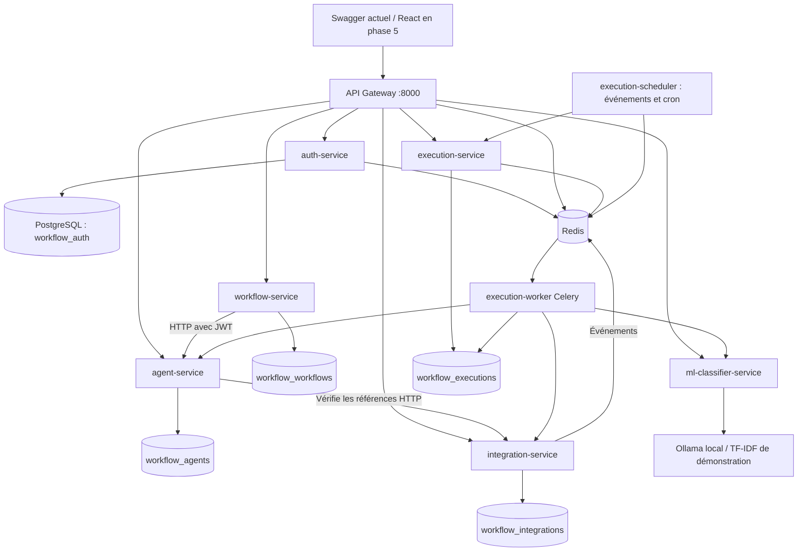
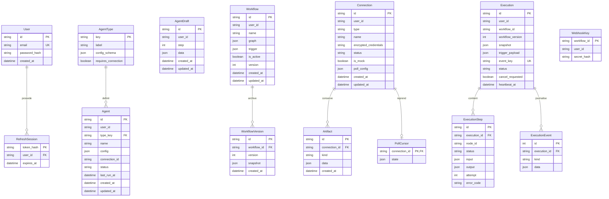

# Plateforme de workflows d’agents

Application de classe inspirée de n8n : création d’agents, assemblage visuel de workflows et exécutions traçables. Le développement suit les six phases du cahier des charges.

**Livré actuellement : phases 1 à 4.** Authentification, agents, workflows versionnés, connexions chiffrées, connecteurs et classification sont complétés par un moteur Celery, des déclencheurs automatiques, un historique détaillé et un flux SSE. L’interface React reste en phase 5.

Démonstration actuelle : Swagger et `make smoke` permettent de recevoir un document Telegram simulé, le classifier, enregistrer une ligne Sheets, préparer un email et une réponse Telegram simulés. Ce parcours s’exécute désormais dans le worker Celery, manuellement puis automatiquement après réception Telegram simulée. La capture/GIF finale montrera le wizard, le canevas puis les cinq étapes Telegram → Classification → Sheets → Gmail → Telegram ; elle sera ajoutée après la phase frontend.

## 1. Architecture et services



| Service | Rôle | État |
|---|---|---|
| api-gateway | JWT, routage REST, CORS, limitation Redis, OpenAPI agrégé | Livré |
| auth-service | Inscription, connexion, profil, rotation des refresh tokens | Livré |
| PostgreSQL 16 | Cinq bases : auth, agents, workflows, intégrations et exécutions | Livré |
| Redis 7 | Limitation atomique des requêtes, persistance AOF | Livré |
| secrets-init | Génère les clés JWT et Fernet dans un volume privé ; s’arrête avec le code 0 | Livré |
| databases-init | Provisionne bases et rôles métier sans effacer le volume existant | Livré |
| agent-service | Catalogue, CRUD, brouillons, états | Livré |
| workflow-service | Graphes, versions, validation, activation | Livré |
| integration-service | Connexions Fernet, OAuth, connecteurs et polling vers Redis | Livré |
| ml-classifier-service | Ollama, classes configurables, extraction et repli TF-IDF | Livré, sans base de données |
| execution-service | Soumission, historique, annulation et SSE | Livré |
| execution-worker | Moteur Celery, deux tâches concurrentes | Livré |
| execution-scheduler | Consommation Redis, cron, reprise des soumissions | Livré |
| frontend | React, wizard, React Flow, historique | Phase 5 |

Seule la gateway est publiée, sur l’interface locale `127.0.0.1`. Les services ne partagent pas leurs tables. Chaque futur service persistant recevra une base et un rôle propres. Les échanges interservices se feront par HTTP ou Redis.

## 2. Installation en trois commandes

Prérequis : Docker Engine et Docker Compose avec prise en charge de `--wait`, ports locaux disponibles, accès Internet au premier build. Python 3.11+ et Make sont nécessaires uniquement pour développer et tester hors Docker.

```bash
[ -f .env ] || cp .env.example .env
docker compose up --build
# Dans un autre terminal :
xdg-open http://localhost:8000/docs
```

Sur macOS/Windows, ouvrir cette URL dans le navigateur. La clé JWT est générée automatiquement au premier lancement et conservée dans le volume `service-secrets`. Aucun identifiant Google ni Telegram n’est nécessaire en mode démonstration. Les clés JWT et Fernet sont conservées dans le même volume privé.

Pour démarrer en arrière-plan, attendre les healthchecks puis vérifier :

```bash
make up
docker compose ps -a
curl --fail http://localhost:8000/health
```

Les onze services persistants doivent être `healthy`. `secrets-init` et `databases-init` doivent être `Exited (0)` : ce sont des tâches d’initialisation. Les migrations Alembic s’appliquent avant le démarrage de chaque service possédant une base. Le démarrage échoue si elles échouent.

Le provisionnement crée les rôles `workflow_agents`, `workflow_workflows`, `workflow_integrations`, `workflow_executions` et leurs bases respectives. Les mots de passe locaux sont `AGENT_DB_PASSWORD`, `WORKFLOW_DB_PASSWORD`, `INTEGRATION_DB_PASSWORD`, `EXECUTION_DB_PASSWORD`. Les connexions aux bases métier sont refusées aux autres rôles non administrateurs. Le rôle PostgreSQL de la phase 1 reste administrateur local ; les nouveaux services utilisent leurs rôles limités. Le provisionnement est idempotent et fonctionne aussi sur le volume de la phase 1. Il ne change pas le mot de passe d’un rôle déjà créé : une rotation doit modifier le rôle PostgreSQL et `.env` ensemble.

`docker compose down` arrête l’application en conservant comptes et clé. `docker compose down -v` **efface les données et la clé**, et invalide les sessions : réserver cette commande à une réinitialisation volontaire. Le mot de passe PostgreSQL fourni est une valeur de développement pour une base sans port publié ; le remplacer avant tout déploiement. Changer `.env` ne modifie pas le mot de passe d’une base déjà initialisée.

Pour choisir un autre port : définir `GATEWAY_PORT` dans `.env`. Adapter `API_URL` pour le smoke test. `.env` n’est jamais versionné.

## 3. Configuration des intégrations

Les connecteurs sont implémentés. Le mode effectif est démonstration si `MOCK_INTEGRATIONS=true` **ou** si un identifiant OAuth Google est absent. L’avertissement est visible dans les logs et via `GET /integrations/status` ; il sera affiché par la page Connexions en phase 5. Aucune connexion réelle existante ne peut être utilisée tant que le mode démonstration est actif. Ne recopiez pas de secret dans un fichier versionné, un exemple HTTP ou ce README.

### Google OAuth et Checklist Google

Le projet `gmail-agent`, les API Gmail et Sheets et un client OAuth sont déclarés comme déjà créés dans le cahier des charges. La capture ne permet pas de vérifier les autres réglages. Une seule connexion OAuth servira Gmail et Sheets.

1. Dans Google Cloud, sélectionner le projet existant ou en créer un.
2. Activer **Gmail API**, **Google Sheets API** et **Google Drive API** ; cette dernière permet de lister les classeurs.
3. Configurer le consentement OAuth : audience **Externe**, mode **Test** ; ajouter son adresse dans les utilisateurs de test de la section **Audience**. Renseigner la même adresse dans `GOOGLE_TEST_USER_EMAIL` du `.env` local.
4. Dans **Accès aux données**, ajouter uniquement :
   - `https://www.googleapis.com/auth/gmail.readonly`
   - `https://www.googleapis.com/auth/gmail.send`
   - `https://www.googleapis.com/auth/spreadsheets`
   - `https://www.googleapis.com/auth/drive.metadata.readonly`
5. Utiliser un client OAuth de type **Application Web**, avec l’URI de redirection exacte : `http://localhost:8000/api/v1/integrations/google/oauth/callback`.
6. Renseigner localement `GOOGLE_CLIENT_ID`, `GOOGLE_CLIENT_SECRET` et `GOOGLE_REDIRECT_URI`. Ne jamais envoyer ces valeurs au dépôt. Si le port de la gateway change, adapter aussi le port de cette URI et la même URI autorisée dans Google Cloud ; les tests au port 18000 restent en démonstration Google.
7. Désactiver `MOCK_INTEGRATIONS` une fois les variables réelles remplies, redémarrer integration-service et appeler `/integrations/google/oauth/start` avec un access token applicatif. Ouvrir `authorization_url` dans le navigateur. Le flux utilise `access_type=offline`, `prompt=consent`, PKCE et un état chiffré à usage unique valable dix minutes, lié au navigateur par un cookie HttpOnly SameSite=Lax. Utiliser le même navigateur et le même hôte pour démarrer et terminer OAuth. Un frontend séparé devra inclure les cookies (`credentials: "include"`) lors du démarrage OAuth. Le callback retourne uniquement les métadonnées de la connexion. [Flux Google officiel](https://developers.google.com/identity/protocols/oauth2/web-server)
8. Les access/refresh tokens sont chiffrés avec Fernet. Un renouvellement est tenté avant expiration et persisté chiffré ; un échec marque la connexion `expired` et renvoie `connection_expired` (« Connexion expirée, reconnecter »). Pour reconnecter, appeler OAuth start avec `?connection_id=<UUID>` ; la connexion doit appartenir au compte et être réelle.

Checklist à terminer : Drive API activée, URI exacte, quatre scopes ajoutés, adresse ajoutée aux utilisateurs de test. `redirect_uri_mismatch` indique une URI différente ; `access_denied` peut venir d’un refus du consentement ou de l’absence dans l’audience de test. L’API renvoie un `help_url` vers `/api/v1/integrations/google/checklist`, accessible sans session. La future interface affichera ce lien. Une erreur bloquée directement par l’écran Google, avant redirection, se corrige dans Google Cloud à l’aide de cette même checklist. Les refresh tokens Google en mode test peuvent expirer après sept jours.

En démonstration, OAuth start retourne une connexion Google locale partagée par Gmail et Sheets, avec un classeur `demo-sheet`, une feuille `Documents` et un message de test. Les lignes ajoutées/modifiées sont persistées ; les envois restent dans `/connections/{id}/outbox`. Les exemples de données sont clairement marqués `mock`.

**Limite des scopes imposés** : lecture, envoi, pièces jointes et lecture des libellés fonctionnent avec les quatre scopes ci-dessus. Ajouter un libellé à un email exige `gmail.modify`, qui n’est pas demandé. L’action `gmail_add_label` renvoie 403 `insufficient_scope`, y compris en démonstration, pour conserver les mêmes permissions. [Scopes de modification Gmail](https://developers.google.com/workspace/gmail/api/reference/rest/v1/users.messages/modify)

### Telegram

Créer un bot via BotFather, conserver son token uniquement dans `TELEGRAM_TOKEN` du `.env`, sans valeur par défaut. En mode réel, `POST /integrations/telegram/connect` avec `{"name":"Mon bot"}` utilise cette variable, teste `getMe` et stocke le token chiffré. Le mode global doit être réel ; des variables Google manquantes activent le mode démonstration pour tous les connecteurs.

La réception réelle utilise `getUpdates` en long polling (20 secondes, dix mises à jour maximum par appel), puis `getFile` et téléchargement borné pour les documents. Texte et documents sont publiés dans Redis. L’action `send_message` utilise `sendMessage`. Une seule instance de réception par connexion est protégée par un verrou Redis ; le curseur est persisté en base. `POLLING_ENABLED=false` coupe le polling automatique. En démonstration, il faut injecter un événement via `inject_update`, puis appeler `/connections/{id}/poll` ; aucun bot externe n’est contacté.

### Gmail SMTP/IMAP de secours

Le type `gmail_smtp` utilise `smtp.gmail.com:587` avec STARTTLS pour l’envoi et `imap.gmail.com:993` pour la lecture. Activer la validation en deux étapes du compte, créer un mot de passe d’application si le compte y est éligible, puis renseigner `GMAIL_APP_PASSWORD` uniquement dans `.env`. Créer une connexion `gmail_smtp` avec `credentials.email`, et éventuellement `credentials.app_password` ; si absent, `GMAIL_APP_PASSWORD` est utilisé. Ce mode n’offre pas Sheets. La lecture utilise IMAP sans marquer les messages comme lus et retourne les pièces jointes encodées en base64. Les filtres disponibles sont `from_email` et `unread` ; les requêtes Gmail `q` et les libellés nécessitent OAuth et sont refusés explicitement en IMAP. Les envois utilisent STARTTLS avec validation du certificat.

### Ollama local

Ollama a été vérifié sur cette machine : `/api/tags` répond et `phi3:latest` est installé. L’adaptateur final a correctement classé les trois textes de démonstration facture / contrat / CV, avec des scores déclarés de 0,98 / 0,95 / 0,95 lors du contrôle du 25 octobre 2026. Ces scores sont fournis par le modèle et ne constituent pas des probabilités calibrées.

```bash
ollama pull phi3
curl http://localhost:11434/api/tags
```

- `OLLAMA_URL` vaut `http://host.docker.internal:11434` dans Compose ; le mapping Linux `host-gateway` est inclus. Ollama doit écouter sur une interface accessible au pont Docker. Sur cette machine, l’accès depuis l’hôte fonctionne, mais l’accès depuis Docker ne permet pas de joindre le modèle : la vérification Docker utilise donc le repli TF-IDF.
- `CLASSIFIER_BACKEND=auto` sélectionne Ollama si le modèle demandé figure dans `/api/tags`, sinon la démonstration TF-IDF. `ollama` force les appels réels ; `demo` impose le mode déterministe. La sélection se fait au démarrage : après avoir installé/démarré le modèle, relancer `docker compose restart ml-classifier-service`. Le backend est indiqué dans `/classes`, `/health` et chaque résultat.
- `OLLAMA_MODEL=phi3`, `CLASSES=facture,contrat,cv` sont configurables. Le prompt utilise cette liste fermée et demande un JSON strict. Classe inconnue, JSON invalide, score non fini ou hors [0,1] déclenchent une nouvelle tentative, puis `label:"inconnu"`. `OLLAMA_RETRIES=2` signifie trois tentatives maximum, chacune bornée par `OLLAMA_TIMEOUT=30`. [API Ollama](https://github.com/ollama/ollama/blob/main/docs/api.md)
- Le résultat contient `label`, `confidence`, `raw`, `scores`, `backend` et `reason`. `confidence_threshold` peut forcer `inconnu`. En mode Ollama, `scores` ne contient que la classe prédite, sans inventer une distribution sur les autres classes.
- Le modèle de démonstration est un vrai calcul TF-IDF avec centroïdes de classes, entraîné sur un petit corpus embarqué ; ses scores sont normalisés et non calibrés. `MODEL_PATH` peut pointer vers un corpus JSON `[["classe","texte d’exemple"], ...]`. Monter ce fichier en lecture seule dans le conteneur et adapter `app/services/adapter.py` pour une autre famille de modèles.
- `/classify` accepte JSON ou multipart `file`, et `/classify/file` fournit un formulaire Swagger. Texte UTF-8, PDF textuel, PNG/JPEG sont reconnus. Limites : fichier 5 Mio, texte 200 000 caractères, PDF 100 pages. Un PDF scanné sans couche texte renvoie `empty_document` et demande un OCR préalable.
- Pour les images : définir `INSTALL_OCR=true` et `OCR_ENABLED=true`, reconstruire le service ; Tesseract utilise français et anglais, avec timeout. Sans OCR, `ocr_disabled` est explicite. Les fichiers temporaires sont supprimés après extraction.
- `/llm` appelle Ollama avec un prompt libre. En backend démonstration, il retourne un résumé extractif de trois phrases maximum, avec `backend:"demo", mock:true` ; il ne prétend pas produire une réponse de LLM.

Aucun `calc.py` n’a été trouvé dans le dépôt ; le type calculator n’est pas ajouté.

### HTTP et événements

Une connexion `http` stocke `credentials.base_url` et éventuellement `credentials.authorization` chiffrés. L’action `request` conserve la même origine, valide les adresses DNS, interdit les réseaux privés par défaut, fixe l’IP validée et conserve Host/SNI. Les redirections ne sont pas suivies et les réponses sont limitées à 1 Mio. `HTTP_ALLOWED_HOSTS` autorise explicitement des hôtes privés lorsque nécessaire. Les secrets connus sont masqués si un serveur les reflète dans sa réponse.

Le polling automatique concerne uniquement les connexions réelles actives, avec quatre réceptions concurrentes maximum. Gmail utilise `GMAIL_POLL_SECONDS` (30 par défaut), Telegram `TELEGRAM_POLL_SECONDS` (1 après chaque long poll) ; `poll_config.interval_seconds` peut personnaliser l’intervalle. Gmail OAuth utilise aussi `poll_config.query` et `label_ids`.

Les événements sont publiés dans le stream Redis `integration.events`, avec `user_id`, `connection_id`, `event_id`, `type` et `payload` JSON. Le curseur n’est validé qu’après publication : une interruption peut répéter un événement. Le moteur déduplique durablement chaque événement par compte, workflow et source incluant la connexion. Les mille derniers identifiants Gmail ou Telegram simulés sont retenus ; les événements réels Telegram utilisent un offset persistant. Le scheduler consomme ce stream avec un groupe Redis et acquitte les événements après soumission persistante.

## 4. Dictionnaire des API livrées

URL de base : `http://localhost:8000`. Corps et réponses JSON. Swagger : `/docs`. Schéma agrégé : `/openapi.json`. Erreurs applicatives : `{"detail":"…","code":"…"}` ; les erreurs 422 ajoutent `errors` avec les noms des champs et messages, sans recopier les valeurs saisies. Les erreurs métier utilisent des codes dédiés et peuvent ajouter `fields` ou `errors`.

| Méthode | URL | Auth | Paramètres / corps | Succès | Erreurs |
|---|---|---|---|---|---|
| GET | `/health` | Non | Aucun | 200 `{"status":"ok","service":"api-gateway"}` | 503 `not_ready` |
| GET | `/docs` | Non | Aucun | 200 HTML Swagger | Dépend du CDN Swagger pour l’affichage |
| GET | `/openapi.json` | Non | Aucun | 200 OpenAPI auth, agents et workflows préfixés | 503 `upstream_unavailable` |
| POST | `/api/v1/auth/register` | Non | `{"email":"student@example.com","password":"example-password-123"}` | 201 `{"id":"uuid","email":"student@example.com","created_at":"date ISO"}` | 409 `email_exists`, 422 `validation_error` |
| POST | `/api/v1/auth/login` | Non | Même structure que register | 200 paire de tokens ci-dessous | 401 `invalid_credentials`, 422 |
| POST | `/api/v1/auth/refresh` | Refresh dans le corps | `{"refresh_token":"valeur reçue à la connexion"}` | 200 nouvelle paire, ancien refresh consommé | 401 `invalid_credentials`, 422 |
| GET | `/api/v1/auth/me` | Bearer access | En-tête `Authorization: Bearer <access_token>` | 200 même profil public que register | 401 `invalid_token` ou `invalid_credentials` |

Réponse de connexion / renouvellement :

```json
{
  "access_token": "JWT access",
  "refresh_token": "JWT refresh",
  "token_type": "bearer",
  "expires_in": 900
}
```

L’email est normalisé en minuscules. Mot de passe : 10 à 128 caractères. L’inscription retourne le profil ; appeler ensuite login. Chaque renouvellement rend l’ancien refresh inutilisable. Conserver la nouvelle paire. Les access tokens restent valides jusqu’à leur expiration (15 minutes par défaut).

Les routes auth peuvent aussi renvoyer 413 `body_too_large` (plus de 16 Kio), 429 `rate_limited` (en-tête `Retry-After: 60`), 503 `rate_limit_unavailable` / `upstream_unavailable`, ou 502 `upstream_error`. Route auth inconnue : 404 `not_found`. Méthode GET/POST incorrecte sur une route auth connue : 405 `method_not_allowed`. Les autres méthodes HTTP non prises en charge sont refusées par FastAPI. Les limites sont par adresse du pair TCP : 20 requêtes/minute pour inscription, login et refresh ensemble, 120/minute partagées entre profil et routes métier. Derrière un proxy, tous les utilisateurs peuvent partager le même quota ; les en-têtes `X-Forwarded-For` ne sont pas considérés fiables.

### Agents, brouillons et workflows

Toutes les routes suivantes portent le préfixe `/api/v1` et exigent **Bearer access**. Les listes répondent par un tableau JSON ; `limit` vaut 100 (1 à 200), `offset` vaut 0. `{id}` est un UUID. Une ressource appartenant à un autre compte retourne le même 404 qu’une ressource absente. Codes communs : 401 `invalid_token`, 404 `not_found`, 422 `validation_error`, 429 `rate_limited`, 503 `upstream_unavailable` / `rate_limit_unavailable`. La taille maximale du corps métier est 1 Mio (413 `body_too_large`).

| Méthode | URL après `/api/v1` | Paramètres / exemple de corps | Exemple de réponse | Erreurs spécifiques |
|---|---|---|---|---|
| GET | `/agent-types` | Aucun | `[{"key":"transform","label":"Transformation","description":"…","icon":"braces","requires_connection":false,"config_schema":{"type":"object","properties":{"mapping":{"type":"object","maxProperties":100}},"required":["mapping"],"additionalProperties":false}}]` | Codes communs |
| GET | `/agents` | `status` parmi draft, active, error, disabled, `type_key`, `limit`, `offset` | `[Agent]`, forme détaillée ci-dessous | 422 si filtre invalide |
| POST | `/agents` | `{"name":"Préparer","type_key":"transform","config":{"mapping":{"text":"Facture 42"}}}` | 201 `Agent`, statut initial `draft` | 422 `unknown_agent_type`, `invalid_agent_config`, `secret_in_config` |
| GET | `/agents/{id}` | UUID | 200 `Agent` | Codes communs |
| PUT | `/agents/{id}` | Champs modifiés : `{"name":"Préparer le document"}` ; `connection_id:null` retire la connexion | 200 `Agent`, remis à `draft` après modification | 422 comme création ; `null` interdit hors connexion |
| DELETE | `/agents/{id}` | UUID | 204 sans corps | Codes communs |
| POST | `/agents/{id}/activate` | Aucun corps | 200 `Agent`, `status:"active"` | 422 `connection_required`, `invalid_agent_config` |
| POST | `/agents/{id}/deactivate` | Aucun corps | 200 `Agent`, `status:"disabled"` | Codes communs |
| GET | `/agent-drafts` | `limit`, `offset` | `[Draft]`, forme ci-dessous | Codes communs |
| POST | `/agent-drafts` | `{"step":3,"data":{"type_key":"gmail_send","name":"Récapitulatif","config":{"to":"student@example.com"}}}` | 201 `Draft` | 422 `unknown_agent_type`, `secret_in_config` |
| GET | `/agent-drafts/{id}` | UUID | 200 `Draft` | Codes communs |
| PUT | `/agent-drafts/{id}` | Remplacement du brouillon : `{"step":4,"data":{"type_key":"gmail_send","config":{"to":"student@example.com"}}}` | 200 `Draft` | 422 comme création |
| DELETE | `/agent-drafts/{id}` | UUID | 204 sans corps | Codes communs |
| GET | `/workflows` | `is_active=true` ou `false`, `limit`, `offset` | `[Workflow]`, forme ci-dessous | Codes communs |
| POST | `/workflows` | `{"name":"Documents","graph":{"nodes":[],"edges":[]},"trigger":{"type":"manual"}}` | 201 `Workflow`, version 1, inactif | 422 si structure invalide |
| GET | `/workflows/{id}` | UUID | 200 `Workflow` | Codes communs |
| PUT | `/workflows/{id}` | Version courante obligatoire : `{"version":1,"name":"Documents entrants"}` | 200 `Workflow`, version 2, inactif | 409 `version_conflict` |
| DELETE | `/workflows/{id}` | UUID | 204, versions supprimées aussi | Codes communs |
| GET | `/workflows/{id}/versions` | UUID, `limit`, `offset` | `[{"version":1,"snapshot":{"name":"Documents","description":"","graph":{"nodes":[],"edges":[]},"trigger":{"type":"manual","schedule":null,"connection_id":null},"is_active":false},"created_at":"date ISO"}]` | Codes communs |
| POST | `/workflows/{id}/validate` | Aucun corps | `{"valid":true,"errors":[],"order":["start","finish"]}` ou `{"valid":false,"errors":[{"code":"cycle","detail":"Le graphe contient un cycle","node_id":null}],"order":[]}` | 503 `agent_service_unavailable` |
| POST | `/workflows/{id}/activate` | Aucun corps | 200 `Workflow`, actif, version incrémentée | 422 `invalid_workflow` avec `errors`, 409 `version_conflict`, 503 `agent_service_unavailable` |
| POST | `/workflows/{id}/deactivate` | Aucun corps | 200 `Workflow`, inactif, version incrémentée si état changé | 409 `version_conflict` |

Formes de réponse (les UUID sont illustratifs et les dates utilisent ISO 8601) :

```json
{
  "id":"11111111-1111-4111-8111-111111111111",
  "user_id":"22222222-2222-4222-8222-222222222222",
  "type_key":"transform", "name":"Préparer", "description":"",
  "config":{"mapping":{"text":"Facture 42"}},
  "connection_id":null, "status":"draft", "last_run_at":null,
  "created_at":"2026-10-25T17:00:00Z", "updated_at":"2026-10-25T17:00:00Z"
}
```

```json
{
  "id":"33333333-3333-4333-8333-333333333333", "step":3,
  "data":{"type_key":"gmail_send","name":"Récapitulatif","description":"","config":{"to":"student@example.com"},"connection_id":null},
  "created_at":"2026-10-25T17:00:00Z", "updated_at":"2026-10-25T17:00:00Z"
}
```

```json
{
  "id":"44444444-4444-4444-8444-444444444444",
  "user_id":"22222222-2222-4222-8222-222222222222",
  "name":"Documents", "description":"", "version":1, "is_active":false,
  "graph":{"nodes":[],"edges":[]},
  "trigger":{"type":"manual","schedule":null,"connection_id":null},
  "created_at":"2026-10-25T17:00:00Z", "updated_at":"2026-10-25T17:00:00Z"
}
```

Les champs supplémentaires sont refusés. Les brouillons autorisent une configuration partielle mais aucun champ `credentials`. Les noms de champs de secrets courants (`token`, `password`, `client_secret`, etc.) sont refusés récursivement dans les configurations d’agents et de brouillons. Les secrets doivent passer par le service de connexions. Le test d’un agent ou brouillon est une exécution asynchrone réelle : envoyer `{"input":{}}` à `/agents/{id}/test` ou `/agent-drafts/{id}/test`, puis consulter l’exécution retournée (202).

Les routes des connecteurs sont détaillées ci-dessous, suivies des routes du moteur.

### Connexions, connecteurs et IA (phase 3)

Toutes les routes ci-dessous sont précédées de `/api/v1`. **Bearer access** est requis, sauf le callback Google (état + cookie du navigateur initiateur) et la checklist publique. Le corps des routes intégrations/classifieur est limité à 10 Mio par la gateway ; les fichiers décodés sont limités à 5 Mio. Un identifiant de connexion inaccessible répond 404 `not_found`.

| Méthode | URL après `/api/v1` | Paramètres / exemple de corps | Réponse | Erreurs propres à la route |
|---|---|---|---|---|
| GET | `/integrations/status` | Aucun | `{"mock_integrations":true,"google_configured":false,"warning":"MODE DÉMONSTRATION : …"}` | 401 |
| GET | `/integrations/connectors` | Aucun | `[{"key":"telegram","actions":{"send_message":{"type":"object","properties":{},"required":[]}},"triggers":["message","document"],"credential_fields":["token"],"required_credentials":["token"],"always_required_credentials":[]}]` ; schémas complets à l’exécution | 401 |
| GET | `/connections` | `limit`, `offset` | `[Connection]`, exemple ci-dessous | 401, 422 |
| POST | `/connections` | `{"type":"google","name":"Google démo","credentials":{}}` ; types embarqués : google, telegram, gmail_smtp, http | 201 `Connection` | 422 `validation_error`, `missing_credentials`, `invalid_credentials_fields` ; 409 `oauth_required` en Google réel |
| GET | `/connections/{id}` | UUID | 200 `Connection`, sans identifiants | 404 |
| DELETE | `/connections/{id}` | UUID | 204 ; supprime identifiants, artefacts et curseur ; révoque aussi les tokens Google réels | 409 `mode_mismatch`, 502 `revoke_failed` |
| POST | `/connections/{id}/test` | Aucun corps | `{"ok":true,"mock":true}` (Telegram ajoute les métadonnées publiques du bot) | 409 `connection_expired`, `mode_mismatch` ; 502 `connector_error`, `google_api_error` |
| POST | `/connections/{id}/actions/{action}` | `{"params":{…}}`, exemples dans le tableau suivant | Résultat de l’action, indicateur `mock` lorsque pertinent | 422 `unknown_action`, `invalid_action_params` ; 403 `insufficient_scope` ; 409 `connection_expired` ; 502 erreur connecteur |
| GET | `/connections/{id}/outbox` | `limit`, `offset` | `[{"id":"UUID","action":{"action":"gmail_send","to":"student@example.com","subject":"Résumé","body":"facture","html":false},"created_at":"date ISO"}]` | 409 `mock_only` en mode réel |
| POST | `/connections/{id}/poll` | Aucun corps | `{"events":[{"event_id":"42","type":"telegram.message","payload":{"chat_id":7,"text":"Facture"}}],"published":1,"mock":true}` | 409 `poll_busy`, 422 `no_trigger`, erreurs connecteur |
| POST | `/integrations/telegram/connect` | `{"name":"Mon bot"}` ; lit `TELEGRAM_TOKEN` en réel (un champ `token` secret peut aussi être fourni) | 201 `Connection`, bot testé | 422 `missing_credentials`, 502 `connector_error` ; la connexion en erreur reste visible si le test échoue |
| GET | `/integrations/google/oauth/start` | `connection_id` facultatif pour reconnecter | Réel : `{"authorization_url":"https://accounts.google.com/…","mock":false}` + cookie HttpOnly ; démo : `{"authorization_url":null,"mock":true,"connection":{…}}` | 404, 409 `mode_mismatch`, 422 `connection_type_mismatch` |
| GET | `/integrations/google/oauth/callback` | **Sans JWT**, `state` et `code`, ou `state` et `error` ; cookie du navigateur initiateur | 200 `Connection`, jamais les tokens | 400 `invalid_oauth_state`, `invalid_oauth_browser`, `access_denied`, `redirect_uri_mismatch`, `oauth_exchange_failed` ; 409 `mode_mismatch` en démonstration ; lien checklist dans `help_url` |
| GET | `/integrations/google/checklist` | **Sans JWT** | `{"items":["Activer Gmail API, …"],"redirect_uri":"http://localhost:8000/api/v1/integrations/google/oauth/callback","scopes":["…"],"label_limitation":"…"}` | Aucune authentification requise |
| GET | `/integrations/sheets/{connection_id}/spreadsheets` | UUID Google | `{"spreadsheets":[{"id":"demo-sheet","name":"Démonstration Workflow"}],"mock":true}` | 422 `connection_type_mismatch`, erreurs Google |
| GET | `/integrations/sheets/{connection_id}/spreadsheets/{sid}/sheets` | UUID, identifiant du classeur | `{"sheets":[{"title":"Documents","sheetId":0}],"mock":true}` | 404 en démo, erreurs Google |
| GET | `/integrations/gmail/{connection_id}/labels` | UUID Google | `{"labels":[{"id":"INBOX","name":"INBOX"}],"mock":true}` | Erreurs Google |
| GET | `/classes` | Aucun | `{"classes":["facture","contrat","cv"],"backend":"demo"}` | 401 |
| POST | `/classify` | JSON `{"text":"Facture TVA total 125 euros","confidence_threshold":0.5}` ou multipart avec champ `file` | `{"label":"facture","confidence":0.98,"raw":"{…}","scores":{"facture":0.98},"backend":"ollama","reason":null}` | 422 `validation_error`, `invalid_document`, `empty_document`, `ocr_disabled`, `ocr_unavailable` ; 413 `file_too_large`, `text_too_large` ; 415 `unsupported_document` |
| POST | `/classify/file` | Multipart, champ `file` | Même réponse que `/classify` | Mêmes erreurs fichier |
| POST | `/llm` | `{"prompt":"Résume ce texte…","temperature":0.2}` | `{"response":"…","backend":"ollama","mock":false}` ou résumé extractif de démonstration avec `mock:true` | 422, 503 `ollama_unavailable` |

Exemple de `Connection` :

```json
{
  "id":"55555555-5555-4555-8555-555555555555",
  "type":"google", "name":"Google démo", "status":"active", "is_mock":true,
  "poll_config":{"query":"is:unread","label_ids":[],"interval_seconds":null},
  "created_at":"2026-10-25T18:00:00Z", "updated_at":"2026-10-25T18:00:00Z"
}
```

Le mode d’une connexion est fixé à sa création : une connexion de démonstration ne devient pas réelle en changeant `.env`. Créer une connexion distincte. `Connection.status` peut être `active`, `error`, `expired`. La suppression retire la ligne plutôt que de conserver un compte révoqué utilisable. `credentials_unreadable` (503) signale une clé Fernet différente de celle qui a chiffré les données.

Les agents utilisent aussi les nouveaux codes `invalid_connection`, `connection_type_mismatch` (422), `connection_unavailable` (409) et `integration_service_unavailable` (503). Une connexion non active peut être référencée dans un brouillon, mais bloque l’activation de l’agent.

### Actions des connecteurs

Appel commun : `POST /connections/{id}/actions/<action>` avec `{"params": <objet du tableau>}` et Bearer access. Les propriétés imprévues sont refusées. Les schémas exacts, champs requis et limites sont fournis par `/integrations/connectors`.

| Connecteur | Action | Exemple de `params` | Résultat principal / limites |
|---|---|---|---|
| google | `gmail_read` | `{"query":"is:unread","from_email":"supplier@example.com","unread":true,"label_ids":["INBOX"],"max_results":10}` | `messages` avec id, sujet, expéditeur, texte et métadonnées des pièces jointes ; 1 à 100 messages |
| google | `gmail_labels` | `{}` | `labels` |
| google | `gmail_attachment` | `{"message_id":"demo-mail","attachment_id":"demo-attachment"}` | `content_base64`, taille ou métadonnées en démo |
| google / gmail_smtp | `gmail_send` | `{"to":"student@example.com","subject":"Résumé","body":"Classe facture","html":false,"attachment":{"filename":"facture.txt","content_type":"text/plain","content_base64":"RmFjdHVyZQ="}}` | Identifiant Gmail ou `sent:true` SMTP ; MIME texte/HTML et pièce jointe facultative |
| google | `gmail_add_label` | `{"message_id":"demo-mail","label_id":"INBOX"}` | Toujours refusé avec les scopes actuels : 403 `insufficient_scope` sur une connexion valide |
| google | `sheets_list` | `{}` | `spreadsheets` (100 premiers classeurs et jeton suivant si Google en fournit un) |
| google | `sheets_tabs` | `{"spreadsheet_id":"demo-sheet"}` | `sheets` |
| google | `sheets_read` | `{"spreadsheet_id":"demo-sheet","range":"Documents!A1:C10"}` | `values` |
| google | `sheets_append` | `{"spreadsheet_id":"demo-sheet","range":"Documents!A:C","values":[["facture",0.93,"fichier.pdf"]]}` | Ajout persistant en démo, `updates` en réel ; valeurs écrites en mode RAW |
| google | `sheets_update` | `{"spreadsheet_id":"demo-sheet","range":"Documents!B1","values":[[0.99]]}` | Plage modifiée |
| google | `sheets_create` | `{"spreadsheet_id":"demo-sheet","title":"Archives"}` | Feuille créée ; 409 `sheet_exists` si déjà présente en démo |
| telegram | `send_message` | `{"chat_id":"demo-chat","text":"Classe facture"}` | Message envoyé ou conservé dans outbox en démo |
| telegram | `get_file` | `{"file_id":"identifiant Telegram"}` | `filename`, `content_base64` ; mode réel uniquement |
| telegram | `inject_update` | `{"chat_id":"demo-chat","text":"Facture 42","document":{"filename":"facture.txt","content_base64":"RmFjdHVyZQ="}}` | Événement de démonstration enregistré, à recevoir ensuite via `/poll` ; interdit en réel |
| gmail_smtp | `gmail_read` | `{"from_email":"supplier@example.com","unread":true,"max_results":10}` | Lecture IMAP sans marquer comme lu, pièces jointes incluses en base64 ; `query`/`label_ids` non vides refusés |
| http | `request` | `{"path":"/items","method":"POST","body":{"label":"facture"}}` | `status_code`, `data`, `mock` ; `url` absolue facultative doit conserver l’origine de `base_url` |

La simulation Google prend en charge les plages A1, `is:unread`, `from:` et les termes simples, pas toute la syntaxe Gmail ou les formules Sheets. Le classeur simulé est borné ; il ne remplace pas l’API Google. Les appels réels ne sont pas automatiquement répétés pour éviter de dupliquer un envoi ou une ligne.


Collection exécutable : [docs/api.http](docs/api.http), compatible avec REST Client. Elle lit les tokens de la réponse de login sans les écrire sur disque. Chaque service expose également `/docs`, `/openapi.json` et `/health` dans le réseau Docker, sans port hôte. Les schémas et les références OpenAPI sont préfixés par service pour éviter les collisions.

## 5. Créer un agent

Le wizard graphique à cinq étapes reste prévu en phase 5. Ses API sont disponibles dès maintenant :

1. **Type** : consulter `GET /agent-types` et son `config_schema`.
2. **Connexion** : créer/tester une connexion, puis conserver son UUID `connection_id`. L’existence, l’appartenance et le type sont contrôlés par HTTP lors de la création/modification d’un agent ; l’activation exige un état `active`. Aucun token ne doit être stocké dans `config`. Le test de connexion reste une action explicite, distincte de la vérification des métadonnées.
3. **Configuration** : remplir les paramètres du schéma ; un brouillon incomplet peut être sauvegardé par `POST /agent-drafts`, puis restauré par `GET /agent-drafts/{id}`. `PUT` remplace son contenu et son étape (1 à 5).
4. **Test** : `/agent-drafts/{id}/test` soumet une configuration complète au worker ; consulter ensuite son historique ou son flux SSE.
5. **Résumé et activation** : `POST /agents`, puis `POST /agents/{id}/activate`. Le statut initial est `draft`. Une connexion est obligatoire pour les types Google/Telegram. Modifier un agent le remet en brouillon ; il faut le réactiver.

Pour tester sans connexion externe, choisir `transform` avec `{"mapping":{"text":"Facture 42"}}`. `last_run_at` reste null tant que le moteur n’a pas exécuté l’agent. Les captures du wizard accompagneront le frontend.

## 6. Créer un workflow

La collection HTTP contient un exemple utilisable de bout en bout pour cette phase : créer deux agents transform, les activer, créer un workflow, le valider, l’activer puis consulter ses versions. Pour un seul nœud, remplacer l’UUID de l’exemple par celui d’un agent actif :

```json
{
  "name":"Préparer un document",
  "graph":{
    "nodes":[{"id":"start","type":"agent","position":{"x":100,"y":100},"data":{"agent_id":"11111111-1111-4111-8111-111111111111","input":{},"timeout_seconds":60,"retries":0}}],
    "edges":[]
  },
  "trigger":{"type":"manual"}
}
```

Un lien a la forme `{"id":"e1","source":"start","target":"finish"}`. Une condition doit avoir exactement deux sorties, avec `sourceHandle:"true"` et `sourceHandle:"false"`. Ces handles sont interdits sur les autres types.

La sauvegarde accepte un graphe incomplet afin de travailler par brouillons. La validation et l’activation exigent un graphe non vide, sans cycle ni références absentes, avec un seul départ ; les identifiants des nœuds/liens doivent être uniques. Tous les agents doivent appartenir au compte et être actifs, vérifiés via l’API agent-service avec le JWT de l’utilisateur. Limites : 200 nœuds et 1 000 liens. Les identifiants de nœuds commencent par une lettre et contiennent lettres ASCII, chiffres, `_` ou `-`.

Déclencheurs : `manual`, `webhook`, `cron` avec `schedule` à cinq champs, `telegram` et `gmail` avec `connection_id`. Telegram exige un départ `telegram_trigger` de même connexion ; Gmail exige `gmail_read` de même connexion. Les déclencheurs automatiques nécessitent un workflow actif ; le lancement manuel accepte un workflow inactif avec des agents actifs.

`PUT /workflows/{id}` exige la version courante et crée une nouvelle version ; un conflit renvoie 409. Toute modification désactive le workflow. Une transition actif/inactif crée aussi une version ; répéter le même état ne la modifie pas. Les instantanés conservent nom, description, graphe, déclencheur et activation. Les références d’agents ne figent pas leur configuration : elles sont revérifiées à chaque validation et le sont à chaque exécution.

Le scénario Telegram trigger → Classification → Sheets append → Gmail send → Telegram send est exécuté et vérifié avec le moteur. Le glisser-déposer React Flow reste en phase 5. Le mapping résout notamment `{{ nodes.<id>.output.<champ> }}`.

## 7. Types d’agents et paramètres

Les 11 types sont stockés par migration dans `agent_types` et exposent un JSON Schema strict (`additionalProperties:false`). Le tableau décrit les paramètres actuels ; les valeurs peuvent contenir des expressions de mapping lorsque le type le permet.

| Type | Connexion requise pour activation | Paramètres |
|---|---|---|
| `telegram_trigger` | Oui | `accept_documents` booléen, défaut indiqué dans le schéma : true |
| `telegram_send` | Oui | `chat_id`, `text` obligatoires |
| `gmail_read` | Oui | `query` (défaut documenté `is:unread`), `max_results` entier 1 à 100 |
| `gmail_send` | Oui | `to`, `subject`, `body` obligatoires ; `html` booléen |
| `sheets_append_row` | Oui | `spreadsheet_id`, `range`, `values` tableau non vide (100 cellules max.) |
| `sheets_read` | Oui | `spreadsheet_id`, `range` obligatoires |
| `document_classifier` | Non | `confidence_threshold` de 0 à 1, `classes` liste non vide sans doublons |
| `llm` | Non | `prompt` obligatoire, `temperature` de 0 à 2 |
| `condition` | Non | `field`, `operator`, `value` obligatoires ; opérateurs `eq`, `ne`, `gt`, `gte`, `lt`, `lte`, `contains` |
| `http_request` | Non | `url` obligatoire, `method` parmi GET/POST/PUT/DELETE, `body` JSON facultatif |
| `transform` | Non | `mapping` objet obligatoire (100 propriétés max.) |

Les valeurs par défaut des JSON Schemas sont des indications pour le futur formulaire ; la phase 2 n’injecte pas ces valeurs dans les configurations persistées. Le moteur applique les valeurs d’exécution par défaut. Un agent actif est configuré et activé, sans garantie actuelle de connectivité externe. Le type calculator dépendra de la présence du script existant.

### Moteur, historique et déclencheurs (phase 4)

Routes préfixées par `/api/v1`. Bearer access requis, sauf l’appel public de webhook protégé par sa clé.

| Méthode | Route | Corps / paramètres | Résultat |
|---|---|---|---|
| POST | `/workflows/{id}/run` | `{"payload":{},"event_id":"demo-1"}` ; en-tête `Idempotency-Key` prioritaire | 202, exécution `queued` ou exécution déjà créée |
| POST | `/agents/{id}/test` | `{"input":{}}` | 202, exécution d’un agent enregistré |
| POST | `/agent-drafts/{id}/test` | `{"input":{}}` | 202, test d’un brouillon complet |
| GET | `/executions` | `workflow_id`, `status`, `limit` ≤ 200, `offset` | Historique du compte |
| GET | `/executions/{id}` | UUID | Graphe et nom archivés, version, statuts, entrées/sorties des étapes, tentatives et erreurs |
| POST | `/executions/{id}/cancel` | Aucun | Annulation immédiate en attente, coopérative en cours |
| GET | `/executions/{id}/stream` | `after_id` ou en-tête `Last-Event-ID` | Flux SSE avec identifiants persistants et événement `complete` |
| POST | `/workflows/{id}/webhook-key` | Aucun ; workflow de type webhook | Nouvelle clé `secret`, affichée une seule fois ; rotation de l’ancienne |
| POST | `/webhooks/{id}` | Objet JSON brut ; `X-Webhook-Secret` et `Idempotency-Key` obligatoires | 202 ; workflow actif requis |
| POST | `/integrations/http/request` | `{"url":"https://example.org","method":"GET"}` | Requête HTTP sans connexion enregistrée, soumise à la politique réseau existante |

Une ressource d’un autre compte retourne 404 ; clé webhook invalide : 403 ; configuration ou mapping invalide : erreur explicite. Les statuts d’exécution sont `queued`, `running`, `success`, `failed`, `cancelled`. Une étape peut aussi être `pending` ou `skipped`. Le test isolé accepte un agent non actif ; une exécution de workflow exige des agents actifs.

Le moteur fige graphe, version et configurations à la soumission. Il revérifie les agents avant chaque étape ; une configuration modifiée ou un agent désactivé arrête l’exécution. Les nœuds s’exécutent dans l’ordre topologique ; une condition active uniquement les liens de la branche choisie, les autres deviennent `skipped`, et les jonctions attendent leurs prédécesseurs.

Les expressions lisent uniquement des chemins JSON dans `input`, `trigger` et `nodes`, par exemple `{{ nodes.classify.output.label }}` ou `{{ input.items[0].text }}`. Une expression seule conserve le type JSON ; une interpolation produit du texte. Aucun appel, attribut Python ou `eval` n’est permis. `node.data.input` permet de mapper l’entrée d’une étape ; sans mapping, l’entrée provient des prédécesseurs. Les entrées/sorties sont limitées à 8 Mio ; les fichiers décodés à 5 Mio. Pour Sheets, une liste simple de cellules devient une ligne.

Le déclencheur Gmail transmet le message déjà reçu au nœud de départ. Le classifieur récupère les pièces jointes Gmail via la connexion source si nécessaire. Une lecture Gmail manuelle retourne une liste de messages : mapper explicitement le message voulu avant classification.

Les tâches Celery ne transportent que l’UUID d’exécution. La base conserve la soumission avant publication ; un dispatcher reprend les soumissions en attente. Un identifiant d’événement fourni empêche durablement une double création pour le même compte, workflow et source. Sans identifiant manuel, chaque appel crée une exécution. Les webhooks conservent seulement le SHA-256 de leur secret.

Un verrou Redis de 30 secondes et un heartbeat toutes les cinq secondes empêchent deux workers de traiter simultanément une même exécution. Un worker interrompu est détecté après 90 secondes et l’exécution passe en échec ; elle n’est pas rejouée automatiquement. Les retries sont explicites, bornés par la configuration des agents, avec délai progressif ; une connexion expirée n’est pas retentée. Une action déjà acceptée par un fournisseur avant un timeout peut être dupliquée par un retry : aucune garantie d’effet externe exactement unique. L’annulation ne défait pas un email ou un message déjà envoyé. Voir les [règles Celery sur les acquittements et tâches idempotentes](https://docs.celeryq.dev/en/stable/userguide/tasks.html).

Cron utilise cinq champs, le fuseau `SCHEDULER_TIMEZONE` (`Africa/Ouagadougou` par défaut), une vérification toutes les cinq secondes et une déduplication par minute. Il n’y a pas de rattrapage des minutes manquées pendant un arrêt. `SCHEDULER_ENABLED=false` coupe les déclencheurs automatiques, tout en conservant le dispatcher des exécutions manuelles et la détection des interruptions.

Le flux SSE traverse la gateway sans mise en mémoire tampon. Utiliser `fetch` avec l’en-tête Authorization et reprendre avec `Last-Event-ID` ; aucun JWT dans l’URL. Le serveur clôt le flux après dix minutes, permettant une reconnexion. L’historique restitue le graphe archivé même si le workflow a ensuite changé. Les API internes de rapport d’agent et de liste des workflows actifs exigent un JWT de service signé avec portée appropriée ; elles ne sont pas exposées par la gateway.


## 8. Modèle de données actuel



`token_hash` est le SHA-256 du `jti` aléatoire, pas le refresh token. Sa suppression atomique empêche la réutilisation concurrente. Les sessions expirées sont nettoyées lors de l’émission de tokens. Les agents et brouillons résident dans `workflow_agents`, les workflows et versions dans `workflow_workflows`. `user_id` et `connection_id` sont des références logiques sans clé étrangère entre bases. Les connexions chiffrées, artefacts de démonstration et curseurs résident dans `workflow_integrations`. Les exécutions, étapes, événements SSE et clés webhook résident dans `workflow_executions`, avec leur rôle limité propre. Le service ML est sans état persistant.

Migrations : `services/auth-service/migrations/versions/001_users.py`, `services/agent-service/migrations/versions/001_agents.py`, `services/workflow-service/migrations/versions/001_workflows.py`, `services/integration-service/migrations/versions/001_connections.py`, `services/execution-service/migrations/versions/001_executions.py`. Aucune création implicite des tables en production ; Alembic constitue la source des changements de schéma.

## 9. Ajouter un connecteur ou un type

Pour ajouter un type dès maintenant, créer une migration Alembic dans agent-service qui insère une ligne dans `agent_types` (`key`, `label`, `description`, `icon`, `config_schema`, `requires_connection`). Le schéma doit être un JSON Schema valide et refuser les propriétés imprévues. Ajouter un test de création valide/invalide et vérifier la migration avant activation. Implémenter également le comportement du nouveau type dans `services/execution-service/app/services/actions.py`.

Le registre charge les fichiers Python de `integration-service/app/connectors/`. Ajouter un seul fichier qui hérite de `BaseConnector` et porte `@register`. Le contrat est `test_connection`, `execute`, le dictionnaire `actions` (modèles Pydantic) et la liste `triggers` ; un connecteur récepteur implémente aussi `poll`. Le chargement est automatique au démarrage, sans éditer le registre. Exemple complet d’un connecteur local sans effet externe :

```python
from app.connectors.base import BaseConnector
from app.connectors.registry import register
from app.schemas.actions import Empty

@register
class EchoConnector(BaseConnector):
    key = "echo"
    actions = {"ping": Empty}
    triggers = []

    def test_connection(self):
        return {"ok": True}

    def execute(self, action, params):
        return {"message": "pong"}
```

Pour des identifiants propres au connecteur, déclarer `credential_fields`, `required_credentials` (mode réel) et éventuellement `always_required_credentials` sur sa classe. La création HTTP valide ces champs et chiffre leurs valeurs sans modification du registre ou des schémas globaux. Le type doit correspondre à `[a-z][a-z0-9_]*` (32 caractères maximum). Un connecteur externe doit respecter `self.ctx.connection.is_mock` et éviter tout appel réseau en démonstration. Les connecteurs embarqués utilisent cette même interface. Ajouter un connecteur n’autorise pas l’accès direct aux tables d’un autre service.

## 10. Tests et vérification des phases 1 à 4

```bash
python3 -m venv .venv
.venv/bin/pip install -r requirements-dev.txt
make lint
make test
# Pile de test séparée, sans identifiants réels :
GATEWAY_PORT=18000 docker compose -p agent-workflows-qa -f docker-compose.yml -f docker-compose.test.yml up --build -d --wait
API_URL=http://localhost:18000 make smoke
# Conserver les volumes de test :
docker compose -p agent-workflows-qa -f docker-compose.yml -f docker-compose.test.yml down
```

Les tests auth utilisent SQLite isolé pour inscription/login/profil, hachage, erreurs, rotation et rejet des refresh tokens réutilisés, JWT expirés/altérés, healthchecks et montée/descente des migrations. Les tests gateway utilisent HTTP et Redis simulés pour vérifier JWT, routage, CORS, quotas, limites de corps, indisponibilité et agrégation OpenAPI. `make smoke` vérifie réellement auth, gateway, PostgreSQL et Redis, puis catalogue, CRUD, brouillons, isolation entre comptes, graphe de quatre nœuds, versions, activation, rejet de cycle et agrégation OpenAPI. Le test métier nettoie ses agents, brouillon et workflow ; seuls des comptes de test à adresse unique restent dans la base locale. Les tests unitaires ajoutent les contrôles de branches, cron, Telegram et l’aller-retour de chaque migration avec détection de divergence entre schéma et modèles. `scripts/smoke_integrations.py` vérifie en plus la réception, la classification JSON/multipart, la persistance Sheets, les pièces jointes et les outbox simulées, puis nettoie ses connexions. Il refuse de continuer si les intégrations ne sont pas en mode démonstration.

La CI GitHub exécute lint, tests, scan de secrets, validation Compose, démarrage Docker avec healthchecks et smoke HTTP sur Python 3.11. Les images utilisent aussi Python 3.11. Le scan bloque les formats de tokens Telegram, secrets OAuth Google et clés privées ; il n’affiche jamais les valeurs détectées. Il inspecte les fichiers suivis et nouveaux non ignorés.

Commandes d’exploitation :

```bash
docker compose logs -f api-gateway auth-service
docker compose exec auth-service alembic current
docker compose exec agent-service alembic current
docker compose exec workflow-service alembic current
docker compose exec integration-service alembic current
docker compose exec execution-service alembic current
docker compose ps -a
```

Les logs applicatifs sont JSON et portent un identifiant de requête. Ni corps, ni query strings, ni mots de passe, ni tokens ne sont journalisés. Les messages de démarrage uvicorn/Alembic ainsi que Celery et les services PostgreSQL/Redis gardent leur format natif.

### Résultats des phases 1 à 4 — 25 octobre 2026

- **109 tests** : 7 auth, 15 gateway, 8 agents, 15 workflows, 26 intégrations, 14 classification et 24 exécutions. Ruff, Black et scan de secrets complètent les tests.
- Les onze services persistants ont atteint `healthy` ; les deux tâches d’initialisation se terminent avec le code 0. Les cinq services persistants métier utilisent Alembic.
- Le smoke HTTP complet passe sur PostgreSQL, Redis et Celery : parcours de cinq nœuds manuel puis automatique Telegram, déduplication, SSE à travers la gateway, test de brouillon, branches conditionnelles, webhook et cron. Toutes les sorties externes de ce scénario sont simulées.
- Le rôle `workflow_executions` ne peut se connecter à aucune des quatre autres bases : privilèges et tentatives de connexion vérifiés. Le provisionnement retire également les droits PUBLIC hérités sur la base auth.
- La migration PostgreSQL `001_executions` est à jour et `alembic check` ne détecte aucune divergence. Le schéma OpenAPI agrégé expose 46 chemins, 147 références résolues et 57 identifiants d’opérations uniques.
- Les tests du moteur couvrent aussi annulation en attente/en cours, timeout, retries, connexion expirée sans retry, isolation, reprise des soumissions, détection d’un worker interrompu, graphe historique figé et migration aller-retour.
- Ollama natif reconnaît facture, contrat et CV. Depuis Docker, son adresse est résolue mais la connexion est refusée ; le backend auto utilise donc `demo`. Aucun réglage réseau de l’hôte n’a été modifié. Tesseract optionnel n’est pas installé.
- Le jeton Telegram fourni a été vérifié par `getMe` : bot `Freducabot`. Aucun message réel n’a été envoyé. Le consentement Google et les essais Gmail/Sheets réels restent à effectuer.
- Le port 18000 est utilisé car 8000 est occupé. **Exception Docker Snap** : `no-new-privileges:true` bloque le démarrage local ; une surcharge temporaire déjà autorisée est utilisée uniquement pour les tests. Le Compose versionné conserve la protection. Les conteneurs de test et cette surcharge sont retirés après validation, les volumes conservés.

La pile de test utilise `docker-compose.test.yml` pour neutraliser les identifiants réels, activer les simulations et désactiver leur polling réel. Les scripts smoke refusent le mode réel. Sur cette machine, le démarrage protégé standard reste incompatible avec Docker Snap.

## 11. Sécurité et limites

- Argon2id pour les mots de passe, JWT HS256 avec issuer/audience/type/expiration contrôlés dans la gateway et chaque service ; algorithme fixé.
- Clé JWT aléatoire persistante, lecture seule dans les conteneurs applicatifs ; aucune clé de repli codée en dur. Une valeur `JWT_SECRET` explicite doit avoir au moins 32 caractères et être aléatoire.
- Refresh tokens à usage unique, stockage de leur identifiant haché ; aucun mot de passe ou token de session dans les réponses de profil.
- CORS limité aux origines configurées ; base et Redis sans ports hôte ; limite Redis atomique qui refuse les requêtes si Redis est indisponible.
- Conteneurs applicatifs non root, système de fichiers en lecture seule, capacités retirées. PostgreSQL conserve les droits nécessaires à son initialisation.
- `.env`, fichiers OAuth usuels, environnements virtuels et caches exclus du dépôt. Le scan complète cette protection mais ne garantit pas la détection de tous les secrets.
- Fernet protège les identifiants et tokens OAuth dans `Connection.encrypted_credentials`, ainsi que le vérificateur PKCE dans Redis. L’état OAuth est à usage unique, lié au compte et au navigateur ; les cookies du client HTTP partagé ne servent pas à authentifier les autres connexions. `FERNET_KEY` peut fournir une clé explicite ; sinon elle est générée dans le volume privé. Conserver cette clé avec les sauvegardes ; changer une clé existante sans migration rend les anciennes connexions illisibles.

Limites actuelles : absence de frontend, pas de reset de mot de passe, vérification d’email ni endpoint logout ; un access token déjà délivré reste valable jusqu’à expiration. Cette configuration sert au développement local ; un déploiement public demandera notamment HTTPS et gestion des secrets adaptée. Les tests unitaires SQLite sont complétés par le smoke PostgreSQL de Compose. Swagger utilise un CDN pour ses assets. Le polling Gmail examine les vingt messages les plus récents correspondant au filtre : pour des volumes importants, une synchronisation History API paginée reste une amélioration à réaliser. Les simulations ne reproduisent pas toutes les fonctionnalités Google.

## 12. Hypothèses et progression

- La phase 4 a été engagée après les demandes de poursuite de l’utilisateur. La checklist finale des six phases n’est pas encore satisfaite.
- Le dépôt initial contenait uniquement `README.md`, sans code Telegram ni `calc.py`. Les intégrations ont été ajoutées sans réutiliser de code absent ni inventer de secret.
- Après autorisation explicite, les identifiants Google et Telegram fournis ont été enregistrés uniquement dans le `.env` local, ignoré par Git et protégé en lecture/écriture pour son propriétaire (0600). `MOCK_INTEGRATIONS=false` y est configuré. Aucune valeur secrète n’est reproduite ici. Le consentement OAuth doit encore être terminé dans le navigateur.
- En local, un compte créé par l’utilisateur remplace tout compte de démonstration préconfiguré. Le mot de passe PostgreSQL est une valeur de développement, explicitement documentée.
- Les services agents, workflows, intégrations et exécutions disposent de bases et rôles séparés. La gateway et le service ML sont sans tables persistantes. La clé JWT partagée est vérifiée par chaque service, sans faire confiance à un en-tête d’identité envoyé par le client.

| Phase | Livrable | État |
|---|---|---|
| 1 | Compose, auth, gateway, migrations, tests, CI | Validé fonctionnellement ; exception Docker Snap décrite ci-dessus |
| 2 | Agents, workflows, modèles métier | Validé fonctionnellement ; exception Docker Snap décrite ci-dessus |
| 3 | Connecteurs, OAuth, Telegram, Ollama | Validé en démonstration et avec Ollama natif ; essais externes réels à faire avec identifiants |
| 4 | Moteur, déclencheurs, streaming | Validé avec Celery et connecteurs simulés |
| 5 | Interface React et éditeur | À réaliser |
| 6 | Vérification complète, documentation finale, démonstration | À réaliser |

La checklist finale exige encore l’ensemble des phases 5 et 6, ainsi qu’un essai réel Google/Telegram et un accès Ollama depuis Docker avec les paramètres locaux.
